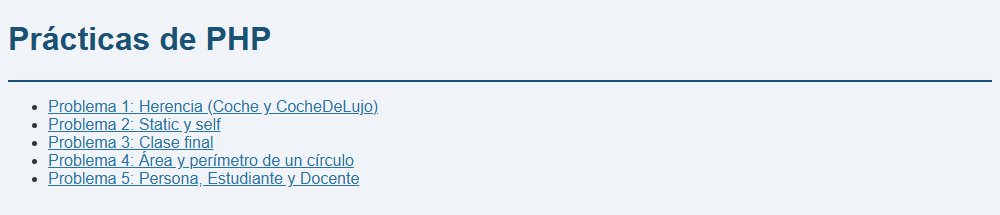
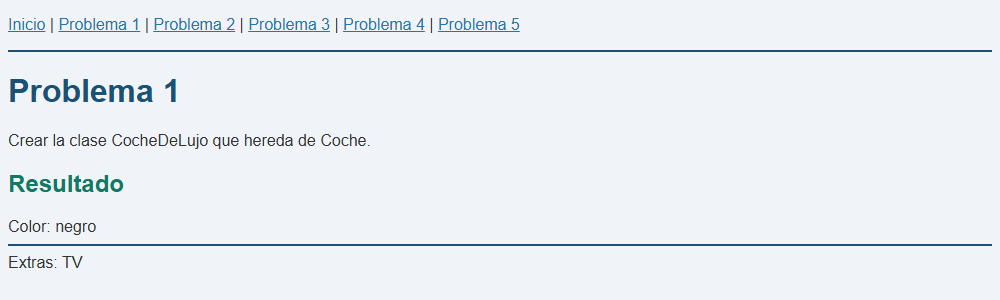
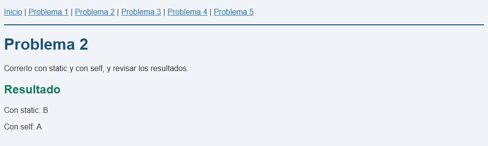
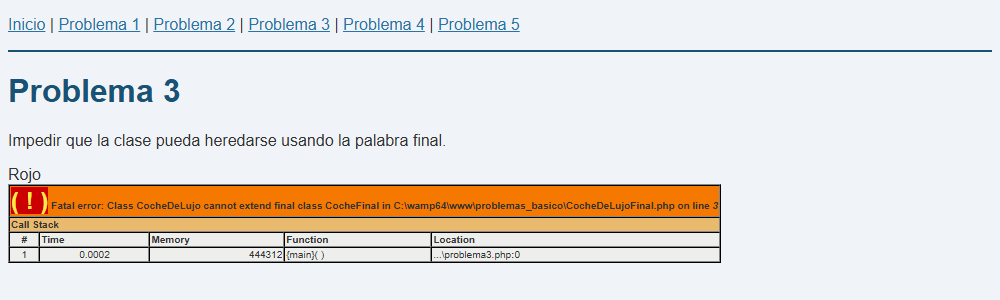
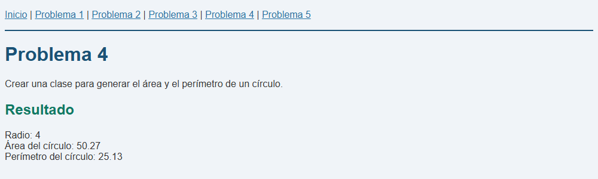
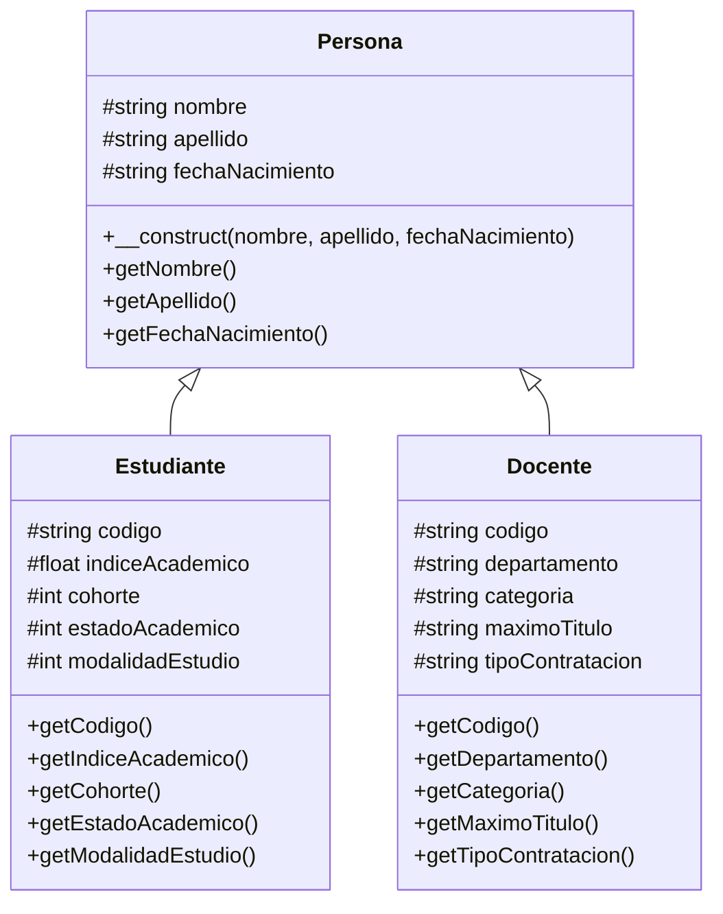
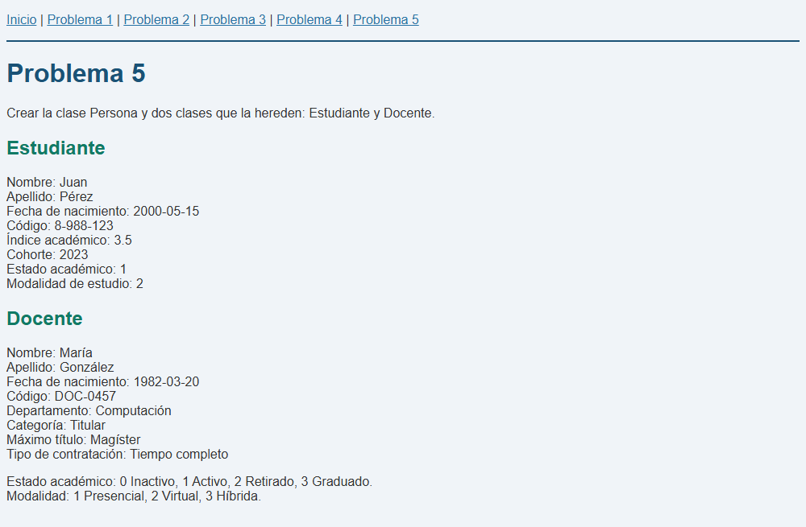
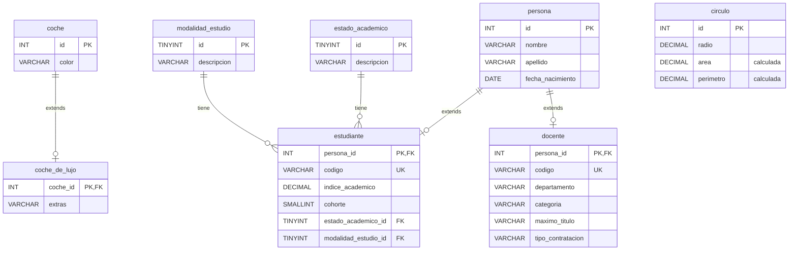

# Práctica #1 — Programación Orientada a Objetos en PHP

Cinco problemas básicos de **Programación Orientada a Objetos (POO)** desarrollados con **PHP 8.3, HTML5, CSS3 y MySQL**, como parte del Módulo III (Programación de Aplicaciones Web). Se trabaja herencia con `extends`, métodos estáticos con `self::` y `static::`, clases `final`, encapsulamiento y constructores con `parent::__construct()`. También incluye el **script SQL** de la base de datos en la carpeta [`sql/`](sql/).

- **Universidad:** Universidad Tecnológica de Panamá (UTP)
- **Profesora:** Ing. Irina Fong
- **Estudiante:** Angel Gálvez
- **Fecha de entrega:** 09 de octubre de 2026

---

## Tabla de contenido

1. [Tecnologías utilizadas](#tecnologías-utilizadas)
2. [Estructura del proyecto](#estructura-del-proyecto)
3. [Cómo ejecutar el proyecto](#cómo-ejecutar-el-proyecto)
4. [Problema 1: Herencia (Coche y CocheDeLujo)](#problema-1-herencia-coche-y-cochedelujo)
5. [Problema 2: Métodos estáticos, `self::` y `static::`](#problema-2-métodos-estáticos-self-y-static)
6. [Problema 3: Impedir que una clase se herede (`final`)](#problema-3-impedir-que-una-clase-se-herede-final)
7. [Problema 4: Área y perímetro de un círculo](#problema-4-área-y-perímetro-de-un-círculo)
8. [Problema 5: Persona, Estudiante y Docente](#problema-5-persona-estudiante-y-docente)
9. [Base de datos (SQL)](#base-de-datos-sql)
10. [Resumen de conceptos de POO aplicados](#resumen-de-conceptos-de-poo-aplicados)

---

## Tecnologías utilizadas

| Tecnología | Versión | Uso |
|---|---|---|
| PHP | 8.3 | Lenguaje del proyecto (POO) |
| Apache | 2.4 | Servidor web (incluido en WampServer) |
| MySQL | 8.4 | Base de datos del script SQL |
| WampServer | 3.x | Entorno local (Apache + PHP + MySQL) |
| HTML5 / CSS3 | — | Páginas de resultados y estilos (`estilos.css`) |

---

## Estructura del proyecto

```text
problemas_basico/
├── index.php              # Menú principal con enlaces a los 5 problemas
├── menu.php               # Barra de navegación que se incluye en cada página
├── estilos.css            # Estilos de todas las páginas
│
├── problema1.php          # Problema 1: herencia Coche → CocheDeLujo
├── Coche.php              #   Clase padre
├── CocheDeLujo.php        #   Clase hija (extends Coche)
│
├── problema2.php          # Problema 2: métodos estáticos, self:: y static::
│
├── problema3.php          # Problema 3: clase final CocheFinal
├── CocheDeLujoFinal.php   #   Intento de heredar de la clase final (genera el error)
│
├── problema4.php          # Problema 4: área y perímetro de un círculo
├── Circulo.php            #   Clase Circulo
│
├── problema5.php          # Problema 5: Persona, Estudiante y Docente
├── Persona.php            #   Clase padre
├── Estudiante.php         #   Clase hija (extends Persona)
├── Docente.php            #   Clase hija (extends Persona)
│
├── sql/
│   └── problemas_basico.sql   # Script de la base de datos
│
├── capturas/              # Capturas de pantalla de cada problema
│
└── README.md
```

---

## Cómo ejecutar el proyecto

1. Instalar y abrir **WampServer**. Esperar a que el ícono se ponga **verde**.
2. Clonar o copiar este repositorio dentro de la carpeta `www` de WampServer:

   ```bash
   cd C:\wamp64\www
   git clone <URL-de-este-repositorio> problemas_basico
   ```

3. Abrir en el navegador:

   ```text
   http://localhost/problemas_basico/
   ```

4. Desde el menú principal se entra a cada problema. Todas las páginas tienen una barra de navegación para pasar de un problema a otro.



---

## Problema 1: Herencia (Coche y CocheDeLujo)

**Enunciado:** crear la clase `CocheDeLujo` que hereda de `Coche`.

**Archivos:** [`Coche.php`](Coche.php), [`CocheDeLujo.php`](CocheDeLujo.php), [`problema1.php`](problema1.php)

### Explicación

- `Coche` es la **clase padre**. Tiene el atributo `$color` y sus métodos `setColor()`, `getColor()` y `printCaracteristicas()`.
- `CocheDeLujo` **hereda** de `Coche` con la palabra clave `extends`. Así recibe todo lo que tiene `Coche` y además agrega el atributo `$extras`.
- El atributo `$color` es `protected`. Eso permite que la clase hija lo use directamente con `$this->color`, mientras que desde fuera de las clases no se puede acceder a él.
- `CocheDeLujo` **sobrescribe** el método `printCaracteristicas()` para mostrar también los extras.

```php
class Coche {
    protected $color;

    public function setColor($color) {
        $this->color = $color;
    }

    public function getColor() {
        return $this->color;
    }

    public function printCaracteristicas() {
        echo 'Color: ' . $this->getColor();
    }
}
```

```php
class CocheDeLujo extends Coche {
    protected $extras;

    public function setExtras($extras) {
        $this->extras = $extras;
    }

    public function getExtras() {
        return $this->extras;
    }

    public function printCaracteristicas() {
        echo 'Color: ' . $this->color;
        echo '<hr/>';
        echo 'Extras: ' . $this->extras;
    }
}
```

**Uso:**

```php
$miCoche = new CocheDeLujo();
$miCoche->setColor('negro');   // método heredado de Coche
$miCoche->setExtras('TV');     // método propio de CocheDeLujo
$miCoche->printCaracteristicas();
```

### Resultado



---

## Problema 2: Métodos estáticos, `self::` y `static::`

**Enunciado:** ejecutar el código con `static` y con `self`, y revisar los resultados.

**Archivo:** [`problema2.php`](problema2.php)

### Explicación

- Un **método estático** (`static function`) pertenece a la **clase** y no a un objeto. Por eso se llama con `Clase::metodo()` sin usar `new`.
- `__CLASS__` es una constante mágica que devuelve el nombre de la clase **donde está escrito** el código.
- La clase `B` hereda de `A` y **sobrescribe** `miFuncion()`.

| Palabra clave | ¿A qué clase apunta? | Llamada | Resultado |
|---|---|---|---|
| `self::` | A la clase **donde se escribió** el método (`A`). Se resuelve cuando se compila el código. | `B::otraFuncionSelf()` | **A** |
| `static::` | A la clase **que hizo la llamada** (`B`). Se resuelve cuando se ejecuta el código (*Late Static Binding*). | `B::otraFuncion()` | **B** |

```php
class A {
    public static function miFuncion() {
        echo __CLASS__;
    }

    public static function otraFuncion() {
        static::miFuncion();   // usa la clase que hizo la llamada
    }

    public static function otraFuncionSelf() {
        self::miFuncion();     // siempre usa la clase A
    }
}

class B extends A {
    public static function miFuncion() {
        echo __CLASS__;
    }
}

B::otraFuncion();      // Imprime: B
B::otraFuncionSelf();  // Imprime: A
```

**Conclusión:** `self::` ignora la herencia y siempre ejecuta el método de la clase donde está escrito. `static::` respeta la herencia y ejecuta la versión sobrescrita de la clase hija.

### Resultado



---

## Problema 3: Impedir que una clase se herede (`final`)

**Enunciado:** impedir que una clase pueda heredarse usando la palabra `final`.

**Archivos:** [`problema3.php`](problema3.php), [`CocheDeLujoFinal.php`](CocheDeLujoFinal.php)

### Explicación

- Si se pone `final` antes de `class`, **ninguna otra clase puede heredar de ella**.
- La clase se puede seguir usando con normalidad para crear objetos (`new CocheFinal()`). Lo único que se bloquea es la herencia.
- En [`CocheDeLujoFinal.php`](CocheDeLujoFinal.php) se intenta heredar de `CocheFinal` a propósito. PHP no lo permite y muestra un **error fatal**, que es la prueba de que `final` funciona.

```php
final class CocheFinal {
    public function getColor() {
        echo "Rojo";
    }
}

$coche = new CocheFinal();   // Sí se permite crear objetos
$coche->getColor();          // Imprime: Rojo
```

```php
// CocheDeLujoFinal.php: intenta heredar de una clase final
class CocheDeLujo extends CocheFinal {
}
```

**Error que se obtiene (este es el resultado esperado):**

```text
Fatal error: Class CocheDeLujo cannot extend final class CocheFinal
```

### Resultado

Primero se imprime `Rojo`, porque el objeto se crea sin problema. Después aparece el error fatal cuando se intenta heredar de la clase `final`.



---

## Problema 4: Área y perímetro de un círculo

**Enunciado:** crear una clase para generar el área y el perímetro de un círculo.

**Archivos:** [`Circulo.php`](Circulo.php), [`problema4.php`](problema4.php)

### Explicación

- La clase `Circulo` recibe el **radio** en su **constructor** y lo guarda en un atributo `private`. Esto es **encapsulamiento**: solo la clase puede leer o cambiar el radio.
- Fórmulas utilizadas (`M_PI` es la constante π de PHP):

| Cálculo | Fórmula | Código |
|---|---|---|
| Área | A = π · r² | `M_PI * ($this->radio * $this->radio)` |
| Perímetro | P = 2 · π · r | `2 * M_PI * $this->radio` |

```php
class Circulo {
    private float $radio;

    public function __construct(float $radio) {
        $this->radio = $radio;
    }

    public function calcularArea() {
        return M_PI * ($this->radio * $this->radio);
    }

    public function calcularPerimetro() {
        return 2 * M_PI * $this->radio;
    }
}
```

**Uso** (con radio = 4):

```php
$miCirculo = new Circulo(4);
echo number_format($miCirculo->calcularArea(), 2);      // 50.27
echo number_format($miCirculo->calcularPerimetro(), 2); // 25.13
```

### Resultado



---

## Problema 5: Persona, Estudiante y Docente

**Enunciado:** a partir de la clase `Persona`, crear las clases `Estudiante` y `Docente`.

**Archivos:** [`Persona.php`](Persona.php), [`Estudiante.php`](Estudiante.php), [`Docente.php`](Docente.php), [`problema5.php`](problema5.php)

### Diagrama de clases



### Explicación

- `Persona` es la **clase padre** con los datos que comparten todos: nombre, apellido y fecha de nacimiento.
- `Estudiante` y `Docente` **heredan** de `Persona` con `extends`, y cada una agrega sus propios atributos.
- Cada clase hija llama al constructor de la clase padre con **`parent::__construct()`**. Así los datos comunes se guardan en un solo lugar y no se repite código.
- Los atributos son `protected` y se leen con métodos **getter**. Esto es **encapsulamiento**.

```php
class Persona {
    protected string $nombre;
    protected string $apellido;
    protected string $fechaNacimiento;

    public function __construct(string $nombre, string $apellido, string $fechaNacimiento) {
        $this->nombre = $nombre;
        $this->apellido = $apellido;
        $this->fechaNacimiento = $fechaNacimiento;
    }
    // ... getters
}
```

```php
class Estudiante extends Persona {
    protected string $codigo;
    protected float $indiceAcademico;
    protected int $cohorte;
    protected int $estadoAcademico;
    protected int $modalidadEstudio;

    public function __construct(
        string $codigo,
        float $indiceAcademico,
        int $cohorte,
        int $estadoAcademico,
        int $modalidadEstudio,
        string $nombre,
        string $apellido,
        string $fechaNacimiento
    ) {
        parent::__construct($nombre, $apellido, $fechaNacimiento); // constructor de Persona
        $this->codigo = $codigo;
        $this->indiceAcademico = $indiceAcademico;
        $this->cohorte = $cohorte;
        $this->estadoAcademico = $estadoAcademico;
        $this->modalidadEstudio = $modalidadEstudio;
    }
    // ... getters
}
```

`Docente` tiene la misma estructura, con los atributos `codigo`, `departamento`, `categoria`, `maximoTitulo` y `tipoContratacion`.

**Códigos que se usan:**

| Estado académico | Modalidad de estudio |
|---|---|
| 0 = Inactivo | 1 = Presencial |
| 1 = Activo | 2 = Virtual |
| 2 = Retirado | 3 = Híbrida |
| 3 = Graduado | |

### Resultado



---

## Base de datos (SQL)

**Archivo:** [`sql/problemas_basico.sql`](sql/problemas_basico.sql)

El script crea la base de datos **`problemas_basico`**, que representa en tablas las clases del proyecto. La **herencia** de PHP se modela con el patrón *una tabla por subclase*: la tabla hija usa como llave primaria la llave de la tabla padre (relación 1 a 1), igual que `extends` en PHP.



| Objeto | Tipo | Problema | Descripción |
|---|---|---|---|
| `coche` / `coche_de_lujo` | Tablas | 1 | Coche padre e hija con los extras |
| `circulo` | Tabla | 4 | El área y el perímetro son **columnas calculadas** con `PI()` |
| `persona` / `estudiante` / `docente` | Tablas | 5 | Persona padre y sus dos tipos |
| `estado_academico` / `modalidad_estudio` | Tablas | 5 | Catálogos de los códigos numéricos |
| `vista_coches_de_lujo`, `vista_estudiantes`, `vista_docentes` | Vistas | 1 y 5 | Unen la tabla padre con la hija para ver el objeto completo |

Los datos insertados son **los mismos** que se usan en los problemas de PHP (coche negro con TV, círculo de radio 4, Juan Pérez y María González).

### Cómo importar el script

**Opción A: phpMyAdmin**

1. Con WampServer encendido, abrir `http://localhost/phpmyadmin`.
2. Ir a la pestaña **Importar**.
3. Seleccionar el archivo `sql/problemas_basico.sql` y presionar **Importar**.

**Opción B: consola de MySQL**

```bash
mysql -u root -p < sql/problemas_basico.sql
```

**Consultas de prueba:**

```sql
USE problemas_basico;

SELECT * FROM vista_coches_de_lujo;  -- negro | TV
SELECT * FROM circulo;               -- radio 4.00 | área 50.27 | perímetro 25.13
SELECT * FROM vista_estudiantes;     -- Juan Pérez | Activo | Virtual
SELECT * FROM vista_docentes;        -- María González | Computación | Titular
```

> [!NOTE]
> El script se puede ejecutar varias veces sin errores. Antes de crear cada tabla y vista, borra la versión anterior con `DROP ... IF EXISTS`.

---

## Resumen de conceptos de POO aplicados

| Concepto | Dónde se aplica |
|---|---|
| **Clases y objetos** | Todos los problemas (`new Coche()`, `new Circulo(4)`, etc.) |
| **Herencia (`extends`)** | Problema 1 (`CocheDeLujo extends Coche`) y Problema 5 (`Estudiante` y `Docente` extends `Persona`) |
| **Sobrescritura de métodos** | Problema 1 (`printCaracteristicas()`) y Problema 2 (`miFuncion()`) |
| **Métodos estáticos** | Problema 2 (`A::miFuncion()`, `B::otraFuncion()`) |
| **`self::` y `static::` (Late Static Binding)** | Problema 2 |
| **Clase `final`** | Problema 3 (`final class CocheFinal`) |
| **Encapsulamiento (`private` / `protected`)** | Problemas 1, 4 y 5 |
| **Constructores** | Problemas 4 y 5 (`__construct`) |
| **`parent::__construct()`** | Problema 5 |
| **Getters y setters** | Problemas 1 y 5 |
| **Propiedades con tipo** | Problemas 4 y 5 (`private float $radio`, `protected string $nombre`) |
